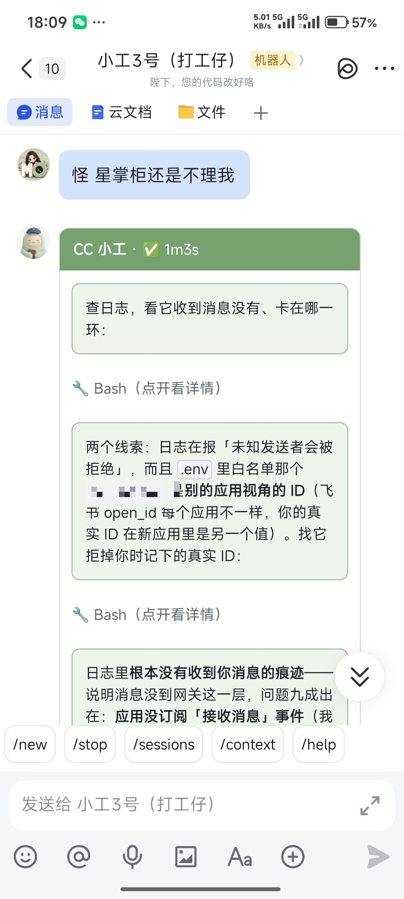
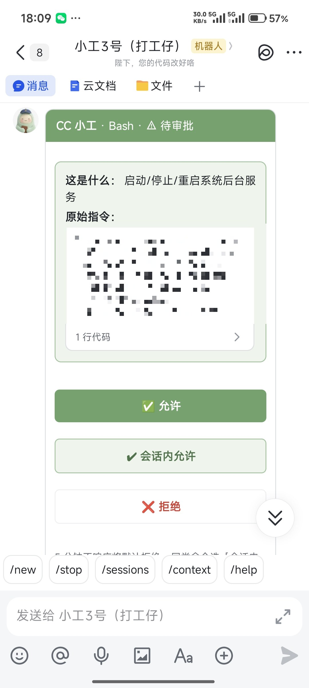
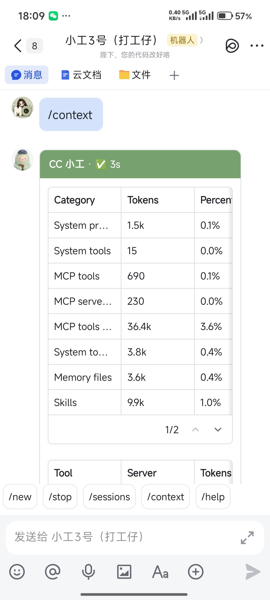

# mycc

**通过飞书机器人远程操控 Claude Code 的本地后端** · Drive your local Claude Code from Feishu — multi-channel, streaming cards, intent-level approvals.

手机飞书发消息 → 本地 Claude Code 干活 → 结果以卡片流式回推到你的飞书会话。轻量 Node/TypeScript 实现，零第三方重依赖，macOS / Linux / Windows 三平台可跑。

> 起源于「cc 小程序」项目（P08），2026-07 正式开源，本仓库为持续迭代的最新版。

## 特性

| | |
|---|---|
| 📱 **飞书长连接** | WebSocket 模式为主（也支持 poll），无需公网回调地址；断网凭证重试自动恢复 |
| 💬 **多通道** | `FEISHU{suffix}_*` 环境变量即插即用多条通道（A/B/C/…每条 = 一个独立飞书应用 = 一个独立 bot），会话/模型/配对互相独立 |
| 🪄 **卡片流式** | 回复流式渲染进飞书卡片；工具调用可折叠压缩（流式/静态卡统一折叠面板），长任务不刷屏 |
| 🎨 **抹茶卡片体系** | Card 2.0 容器：可点按钮+回调、原生 table（点开横屏查看）、审批卡/选项卡/会话卡全套构件（`card-style.ts`） |
| 🔐 **权限三代** | 意图级审批：红线直接拒（rm -rf / sudo / 强推…）→ 硬闸意图弹飞书审批卡（说人话不说命令）→ 其余放行靠 git 兜底 + 轮末「执行摘要」卡事后验收 |
| 🗑️ **回收站删除** | 删除类操作走 trash 免审，天然可逆 |
| ⚡ **稳定性** | 出站发送退避重试、消息合并窗口、session 可恢复错误自动重试、进程看门狗（launchd/systemd/schtasks 三平台适配） |
| 🖼️ **富媒体** | post 富文本图文混排解析、多图聚合、文件收发、图片缓冲合并 |

## 快速开始

```bash
# 要求：官方原版 Claude Code、Node.js 18+、一个飞书自建应用
git clone https://github.com/xiaomo-agi/mycc.git
cd mycc/scripts
npm install
cp .env.example .env   # 填入你的飞书应用凭证
```

启动（推荐守护模式，脱离终端也不会挂）：

```bash
npx tsx src/index.ts start -d     # 守护启动
npx tsx src/index.ts status       # 探测运行/配对状态
npx tsx src/index.ts ps           # 列出后端进程
npx tsx src/index.ts stop         # 优雅停止（SIGTERM 超时 SIGKILL 兜底）
npx tsx src/index.ts restart      # stop + start
npx tsx src/index.ts kill <id|pid>  # 干掉指定进程
```

作为 Claude Code Skill 安装：把本仓库放入 `.claude/skills/mycc`（参考 [SKILL.md](SKILL.md)），即可对 Claude Code 说「启动 mycc」。

## 截图预览

| 流式回复 + 工具调用折叠 | 意图级审批卡 | 原生表格卡 |
|---|---|---|
|  |  |  |

*飞书手机端实拍；敏感信息已打码。*

## 飞书应用配置

1. [飞书开放平台](https://open.feishu.cn) 创建企业自建应用，拿到 App ID / App Secret
2. 开通机器人能力与 `im:message` 相关权限
3. 凭证填入 `.env`（**不要提交进 git**）
4. 默认通道用 `FEISHU_APP_ID` / `FEISHU_APP_SECRET`；WebSocket 长连接模式无需公网地址

全部环境变量见 [.env.example](.env.example)（含多通道 `FEISHU{A,B,C…}_*`、流式开关、指定工作目录等）。

## 权限与安全（三代模型）

```
红线（rm -rf / sudo / git push --force / 改密钥…） → 直接拒绝，不弹卡
硬闸意图（push / 删除 / 装卸软件 / 后台服务 / 数据库结构） → 飞书审批卡（说意图不说命令）
其余（node/python/解压/mv/重定向…日常操作） → 全部放行 + 轮末执行摘要卡事后验收
```

- 私有备份仓 push 豁免：`scripts/src/permissions/approval.ts` 里 `PRIVATE_PUSH_REMOTES` 填 `owner/repo`，或运行时调 `setPrivatePushRemotes()`
- 任何拿不准的命令保守弹卡，宁可多问一句

## 开发

```bash
cd scripts
npm run dev        # tsx 直跑开发模式
npm test           # vitest 全量测试
npm run build      # tsc 编译
```

> 测试中少数用例依赖真实网络/时序（SSE 心跳、飞书通道、配对限流），在无网环境可能个别失败，属预期。

## 测试环境记录

| 项目 | 环境 |
|---|---|
| 主开发/长驻验证 | macOS 26 (Apple Silicon) · Claude Code 官方版 · @anthropic-ai/claude-agent-sdk 0.2.63 · 2026-11 |
| 模型档位 | Claude（主）+ CC Switch 切换的国产模型（GLM / MiniMax，经 CC 接入）· 2026-11 |
| 测试规模 | vitest 1086 用例（含 doctor 16 项；1049+ 过，少量网络/时序用例无网环境预期失败） |
| CI 自动横测 | GitHub Actions：Linux/Windows × Node 18/20 矩阵（tsc 门 + 核心测试门 + 全量信息跑）——已配置，待多平台首跑回归 |
| doctor 自查 | `npx tsx src/index.ts doctor`：Node/Claude Code/trash/凭证/patch-sdk/端口一键体检——已加入，待多环境实测反馈 |
| 待真机验证 | Linux（systemd）/ Windows（schtasks）守护路径、非 Apple Silicon 环境 |

> 按社区共识记录测试所用模型与日期，方便对照「效果来自 skill 还是模型」。欢迎提 issue 补充你在其他环境的实测结果。

## 兼容性与已知边界

- **Claude Code 必须官方原版**。`scripts/scripts/patch-sdk.mjs` 针对特定 SDK 版本的已知 CLI bug 打补丁（Agent Teams 死锁），SDK/CLI 升级后补丁可能需要更新——遇到异常先看补丁是否命中
- **平台差异**：守护进程三平台适配（macOS launchd / Linux systemd / Windows schtasks+watchdog）；「删除走回收站免审」依赖 `trash` 命令（macOS `brew install trash`、Linux `trash-cli`），未安装或 Windows 上该命令会执行失败、删除改走审批卡，不影响其余功能
- **测试**：少数用例依赖真实网络/时序（SSE 心跳、飞书通道、配对限流），无网环境可能个别失败
- 新机器部署自查：`npx tsx src/index.ts status` 探测运行与配对状态

## 项目结构

```
SKILL.md            # Claude Code Skill 定义
scripts/src/
  channels/         # 飞书通道 + 卡片体系（流式/命令/按钮/折叠）
  adapters/         # Claude Agent SDK 会话适配
  permissions/      # 意图级审批三代（红线/硬闸/轮次审计）
  daemon/           # 三平台守护（launchd/systemd/schtasks）
  http-server.ts    # 本地 HTTP API + web 通道 + 多通道装配
  tests/            # vitest 测试套件
```

## 致谢

- [lark-coding-agent-bridge](https://github.com/nicofisi/lark-coding-agent-bridge) 的思路启发
- [@anthropic-ai/claude-agent-sdk](https://www.npmjs.com/package/@anthropic-ai/claude-agent-sdk)、[@larksuiteoapi/node-sdk](https://www.npmjs.com/package/@larksuiteoapi/node-sdk)

## License

[MIT](LICENSE) © xiaomo-agi
